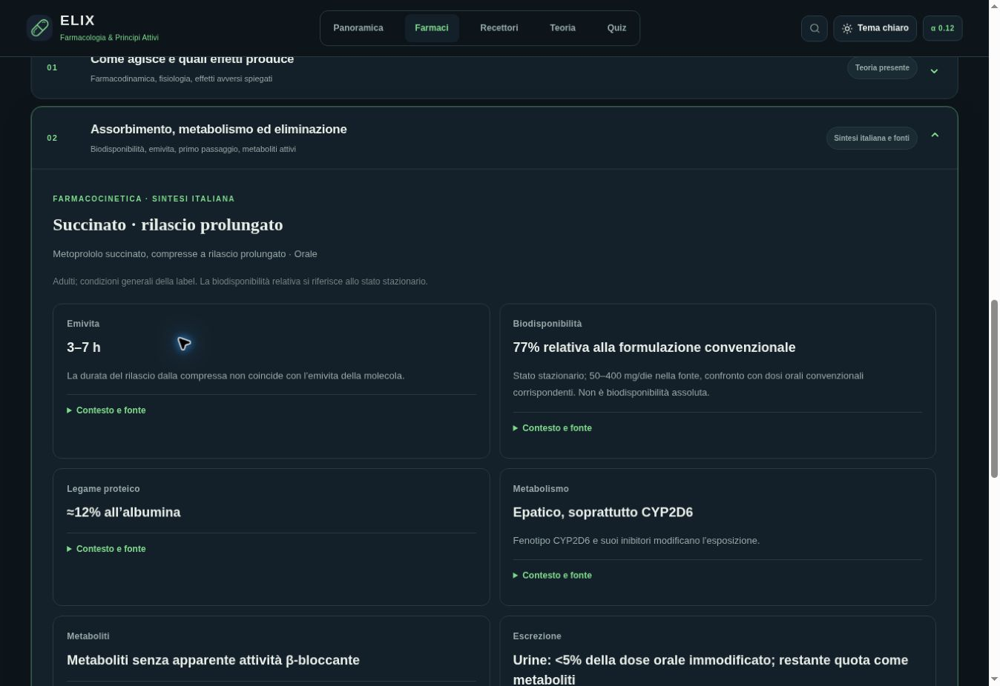

# ELIX Alpha 0.12 — revisione dei nomi e dei riepiloghi PK

Fonti consultate il **22 ottobre 2026**. Base di lavoro: Alpha 0.11, commit `418fb9ae202e9c642d875ef0fc6f07ce584f077a`. Questo documento descrive il lotto implementato e i suoi limiti; non attesta da solo una pubblicazione.

## Problema e cambiamento

La presenza di un documento importato non rendeva automaticamente disponibili i suoi dati nei riepiloghi. Alcuni campi rimanevano generici, mentre il collegamento alla famiglia chimica poteva mostrare il documento di una formulazione diversa. I nomi italiani erano parziali e una ricerca esatta poteva essere preceduta da forme correlate.

La revisione introduce **7 profili PK per 6 molecole**, associati esplicitamente a **10 identità ChEMBL**, con **42 metriche** e **8 fonti primarie**. Le metriche comprendono quantità, descrizioni qualitative e limiti documentati: non sono 42 nuovi valori numerici. I sei campi sono emivita, biodisponibilità, legame proteico, metabolismo, metaboliti ed escrezione.

- `data/pk-reviewed.json` conserva formulazione, via, popolazione, sostanza misurata, tipo di misura, riferimenti e data del controllo. Le date delle label rimangono separate dalla data della revisione editoriale.
- `elix-pk-reviewed.js` collega il profilo alla precisa identità chimica. Il selettore distingue i due prodotti di metoprololo; riepilogo e documenti seguono la scelta. Un sale non eredita automaticamente PK o posologia del parent.
- `italian-names.js` documenta **25 denominazioni aggiuntive** tramite `ITALIAN_NAME_REVIEW_012`. Nomi internazionali, sinonimi e identificatori restano disponibili. La ricerca dà precedenza alle corrispondenze esatte italiane o inglesi.
- Filtro PK e badge includono i sali verificati; le righe del confronto aprono la precisa forma chimica. Un errore di caricamento delle sintesi PK non blocca il catalogo e il collegamento ufficiale resta visibile anche se il testo importato non si carica.
- Brevi spiegazioni originali collegano i dati a distribuzione, metabolismo ed effetto. Non aggiungono dosaggi consigliati né nuove indicazioni autorizzate.

## Esempi controllati

La tabella evidenzia le distinzioni che il rendering deve conservare. Il dataset contiene il dettaglio completo dei sei campi per ogni profilo.

| Molecola | Dato ora leggibile e contesto da preservare | Fonte primaria |
|---|---|---|
| Metoprololo | Succinato a rilascio prolungato: emivita 3–7 h e biodisponibilità **relativa** 77% rispetto al convenzionale, allo stato stazionario. Tartrato convenzionale: 3–4 h, fino a 7–9 h nei metabolizzatori CYP2D6 lenti; biodisponibilità orale ≈50%. I valori appartengono a fonti/prodotti distinti. | [Succinato, §12.3](https://dailymed.nlm.nih.gov/dailymed/drugInfo.cfm?setid=a46cbf09-20e3-4f0d-ab41-221f60fde068); [tartrato, §12.3](https://dailymed.nlm.nih.gov/dailymed/drugInfo.cfm?setid=0ccb9d3c-3f9a-486d-9b27-dc6f3ef6f4ed) |
| Ramipril | Le 13–17 h riguardano il **ramiprilato**, dopo dosi ripetute nelle condizioni della fonte; la fase terminale >50 h resta distinta. Il 28% riguarda ramipril e il 44% l’esposizione a ramiprilato nel confronto orale/EV descritto. | [Ramipril capsule, §12.3](https://dailymed.nlm.nih.gov/dailymed/drugInfo.cfm?setid=45707435-4fc8-457e-9ff2-02d7be9b4a6e) |
| Clopidogrel | Parent ≈6 h; metabolita **attivo** ≈30 min; principale metabolita **inattivo** ≈8 h nel RCP EMA. Assorbimento ≥50% non equivale a biodisponibilità assoluta. Le quote urinarie/fecali descrivono radioattività totale. | [DailyMed, §12.3](https://dailymed.nlm.nih.gov/dailymed/drugInfo.cfm?setid=bb3b5e96-e629-4db5-8ad5-40c17c6dae18); [Plavix, RCP italiano §5.2](https://www.ema.europa.eu/it/documents/product-information/plavix-epar-product-information_it.pdf) |
| Amlodipina | Emivita **terminale** 30–50 h; biodisponibilità **assoluta** 64–90%. L’escrezione urinaria distingue quota immodificata e metaboliti. Profilo riferito alle compresse di besilato. | [Amlodipina besilato, §12.3](https://dailymed.nlm.nih.gov/dailymed/drugInfo.cfm?setid=6efc0ef6-0424-44fc-a9ea-eb30c3b83239) |
| Digossina | Emivita 1,5–2 giorni con funzione renale normale, 3,5–5 giorni nell’anuria; biodisponibilità delle **compresse** 60–80%. Il 50–70% urinario immodificato proviene da uno **studio EV**. | [Digossina compresse, §12.3](https://dailymed.nlm.nih.gov/dailymed/drugInfo.cfm?setid=5886e233-b2da-4acb-be05-9bf40fb8e7f4) |
| Levetiracetam | Emivita adulta **7 ± 1 h**, senza inventare un intervallo min–max; biodisponibilità orale 100%, escrezione urinaria immodificata 66%. Profilo delle compresse a rilascio immediato, esterno alle 37 sintesi editoriali. | [Levetiracetam compresse, §12.3](https://dailymed.nlm.nih.gov/dailymed/drugInfo.cfm?setid=e1b14939-7262-40dc-a334-2b3b72c88d47) |

Sei fonti DailyMed corrispondono a documenti già importati, con `setId`, versione e data confrontati. La fonte del tartrato e il RCP EMA sono riferimenti online aggiuntivi. Nel PDF italiano di Plavix la data di revisione non è valorizzata: il dataset conserva `effectiveDate: null` e la data di consultazione, senza attribuire una versione fittizia.

## Stile Isoelettrica: regola per le prossime modifiche

Usare le variabili cromatiche salvia/petrolio esistenti e mantenere entrambi i temi. La navigazione principale resta **Panoramica, Farmaci, Recettori, Teoria, Quiz**. Le schede conservano sintesi iniziale e **sei sezioni espandibili**. Il marchio resta la pillola verde su fondo blu scuro uniforme, senza gradienti o ombre; la firma resta **App made by Eliseo Peirano · 2026**. Applicare questi vincoli anche ai nuovi dati e approfondimenti.

## Verifiche riproducibili e stato

### Aggiornamenti con una cache già presente

La verifica sul sito ha riprodotto un problema distinto dai dati: durante l'installazione di un nuovo service worker, `cache.addAll(FILES)` poteva riutilizzare risposte ancora fresche nella cache HTTP e copiarle nella nuova versione offline. Il server aveva già il nuovo testo, mentre il browser continuava a mostrare quello precedente dopo l'avviso «Ricarica».

L'installazione ora usa richieste con `cache: 'reload'` per tutte le risorse della versione e attiva il nuovo worker solo dopo il completamento del lotto. Il comportamento di questa modalità è documentato in [Request.cache, MDN](https://developer.mozilla.org/en-US/docs/Web/API/Request/cache). La prova di regressione usa due revisioni di una fixture locale con cache HTTP calda: controlla prima il difetto dell'installazione precedente e poi il caricamento del nuovo JavaScript e dei nuovi dati con l'installazione corretta. Il normale controllo offline resta separato.

### Suite e controllo dell'interfaccia

Dal checkout del repository:

```sh
npm test
```

La suite comprende `validate-reviewed-names.mjs` e `validate-reviewed-pk.mjs`: denominazioni e ricerca bilingue, identità ammesse/escluse, fonti, contesti, valori strutturati e rendering dei sei campi. I controlli software non dimostrano da soli correttezza clinica o completezza editoriale.

Per il controllo manuale:

```sh
npm run dev
```

Aprire `http://127.0.0.1:4173/`, cercare i nomi italiani e inglesi e confrontare metoprololo parent, tartrato e succinato. Controllare anche un sale non coperto, le sei molecole del lotto, fonti e sezioni di sicurezza, entrambi i temi e un viewport mobile. Il valore selezionato deve mantenere formulazione e provenienza; i documenti di un altro prodotto non devono sostituirlo silenziosamente.

**Verifiche locali del lotto:** tutte le dieci suite `npm test` passate dopo le correzioni, compresi i casi di errore HTTP 503 intenzionale. Verificati manualmente tema chiaro/scuro, selettore metoprololo e conservazione del singolo dettaglio di fonte al cambio di tema. La CI esegue la matrice browser generale e la matrice PK specifica; gli esiti effettivi e la distribuzione sono attestati nella PR della release. I rapporti delle versioni precedenti non valgono come prova di questa revisione.



## Limiti e seguito

Il catalogo continua a comprendere identità chimiche, non altrettante monografie complete. Questi profili non coprono tutte le formulazioni, popolazioni speciali o indicazioni delle sei molecole. Una label USA non diventa un RCP italiano; la revisione delle fonti non equivale a validazione clinica indipendente. Nomenclatura e teoria restano da ampliare progressivamente, con nuovi lotti circoscritti e controllabili. Non dedurre un valore mancante per analogia con un sale, un metabolita o una formulazione vicina.
